# Amazon Engineering Challenge – Árvores Balanceadas (AVL e Rubro-Negra)

**Disciplina:** Estruturas de Dados Básicas II
**Autor:** Júlio César Cândido de Santana

Protótipo para registrar, localizar e remover identificadores de encomendas (Black Friday)
usando árvores balanceadas implementadas do zero

## Requisitos
Python 3.8+ (somente biblioteca padrão; sem dependências externas)

## Como executar
```bash
python main.py
```
O programa pergunta qual árvore usar (AVL ou Rubro-Negra) e abre um menu interativo

## Funcionalidades
Inserção, remoção, busca, percurso em ordem, impressão da árvore (na Rubro-Negra com
cor de cada nó: `(R)`/`(B)`, e ANSI em terminais compatíveis), estatísticas (altura,
rotações, recolorações) e validação das propriedades da estrutura

## Decisões de implementação
| Situação | Decisão |
|---|---|
| Inserir valor repetido | Rejeitado; árvore inalterada; retorna `False` |
| Buscar inexistente | Retorna `False` (sem exceção) |
| Remover inexistente | Árvore inalterada; retorna `False` |
| Remoção com 2 filhos | Substitui pelo sucessor em ordem |
| Altura | Vazia = 0; um nó = 1 |
| Rotações | Contam-se rotações simples individuais; rotação dupla = 2 simples |
| Recolorações | Contam-se mudanças reais de cor (nó novo nasce vermelho e não conta) |

## Estrutura
```
main.py             menu interativo
trees/avl.py        AVL (rotações LL, RR, LR, RL)
trees/red_black.py  Rubro-Negra (recoloração + rotações, estilo CLRS com sentinela NIL)
tests/              testes (a adicionar)
```

## Evidências de execução

Todos os prints foram gerados com `python main.py`, `python -m unittest discover -s tests -v` e `python comparativo.py`.

### Testes automatizados (38 testes, mesmos testes nas duas árvores)
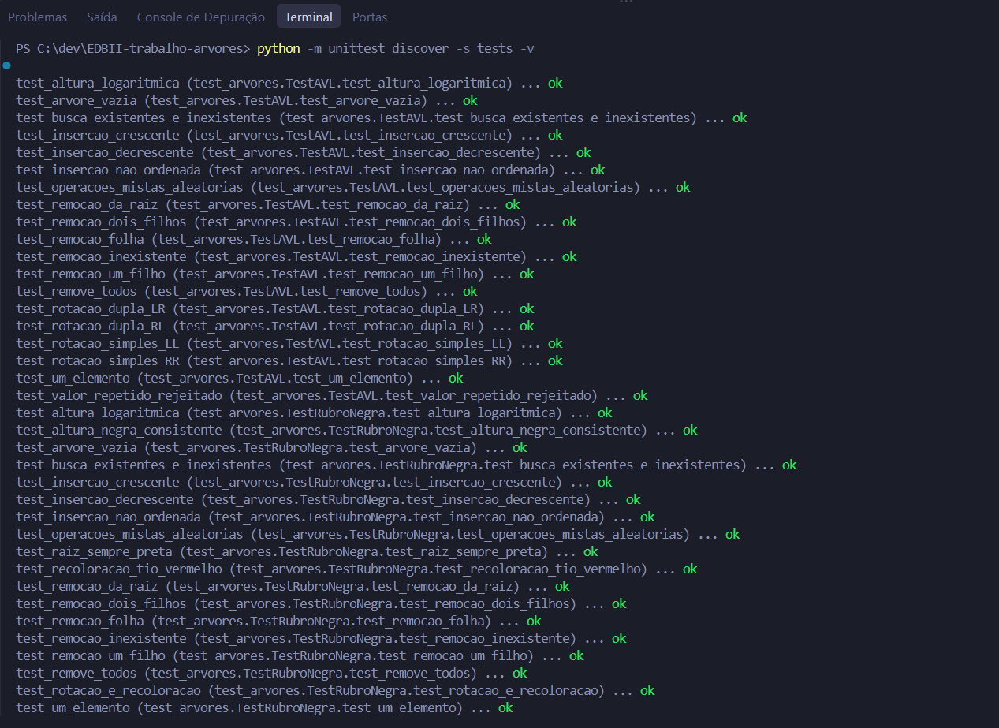
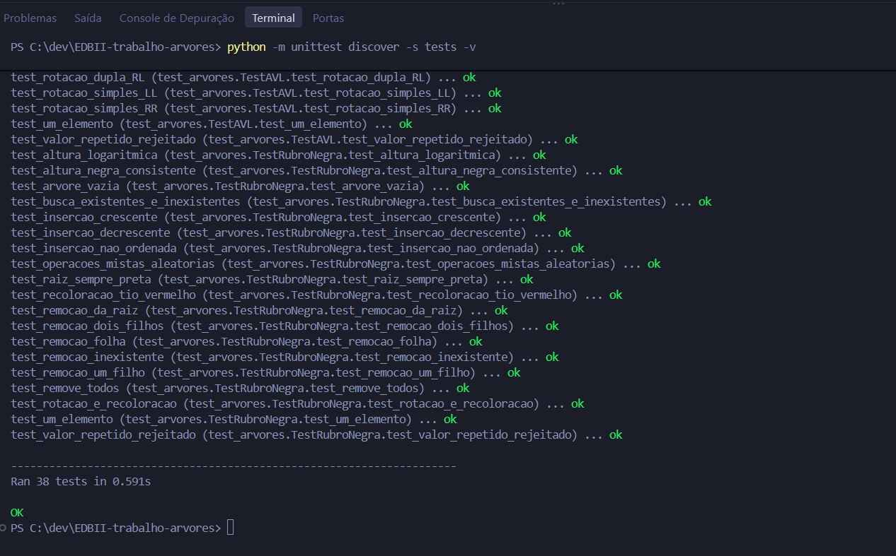

### Comparativo AVL × Rubro-Negra (mesmas sequências)
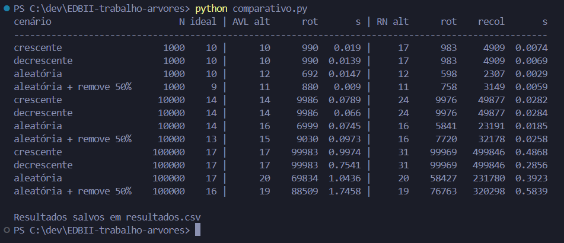

### Árvore AVL
Inserção e impressão da árvore (cada nó mostra o fator de balanceamento):
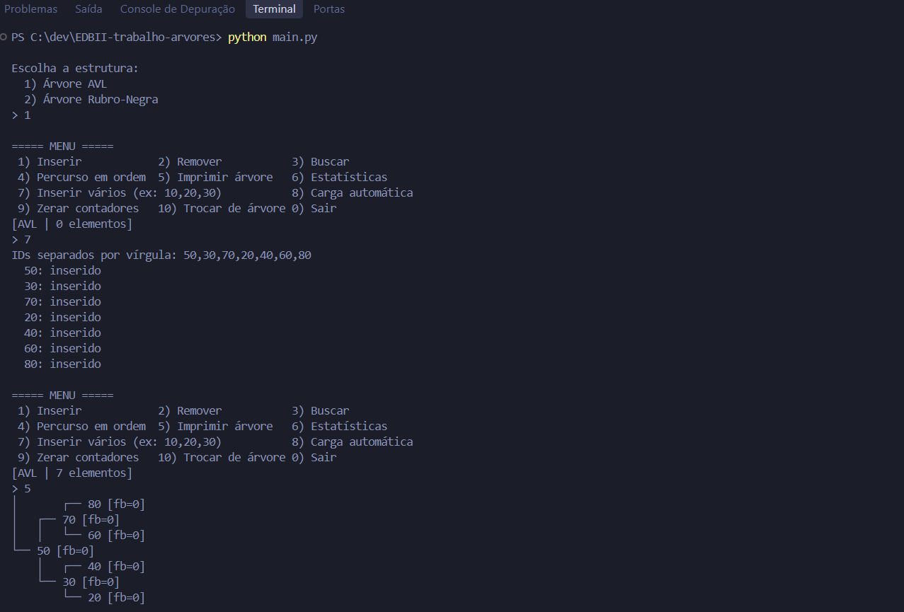

Busca de existente e inexistente, e inserção de valor repetido (ignorada):
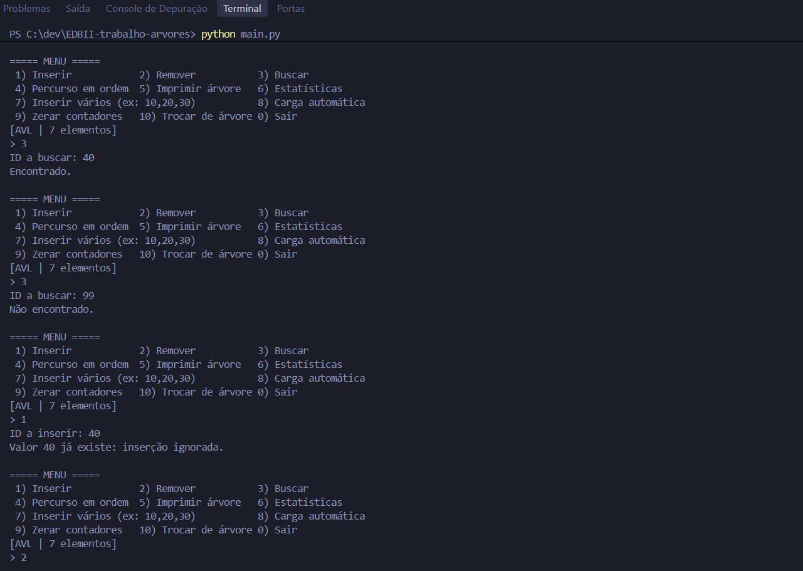

Remoção de folha (20), de nó com dois filhos (70) e de inexistente (99):
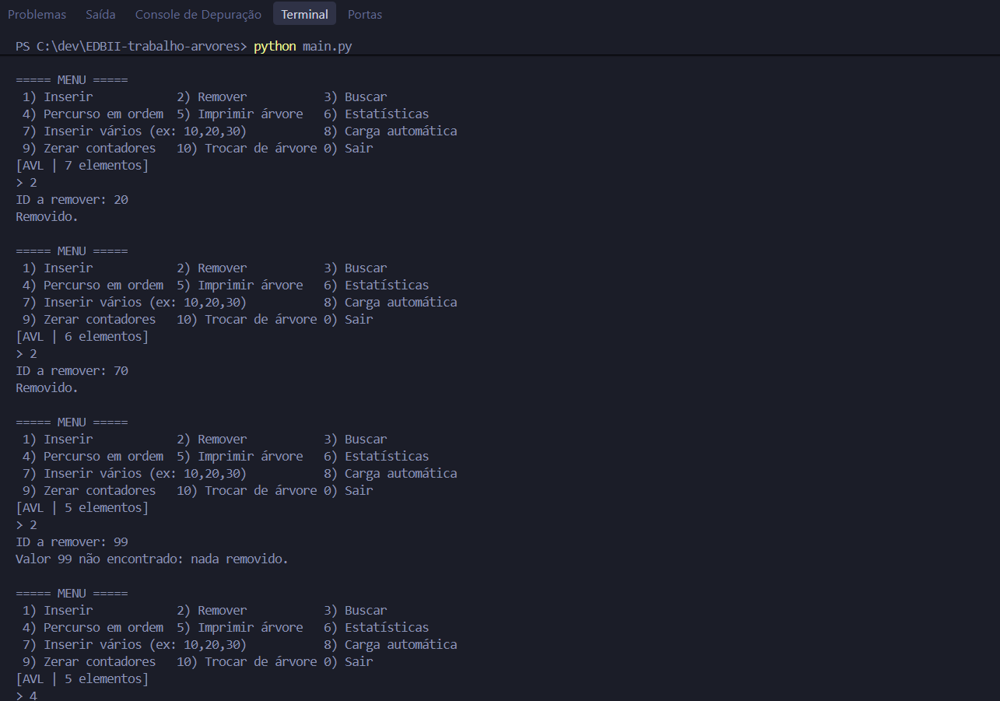

Percurso em ordem, árvore final e estatísticas (propriedades válidas):
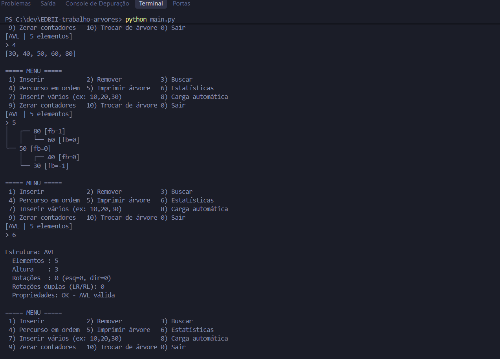

Árvore vazia:
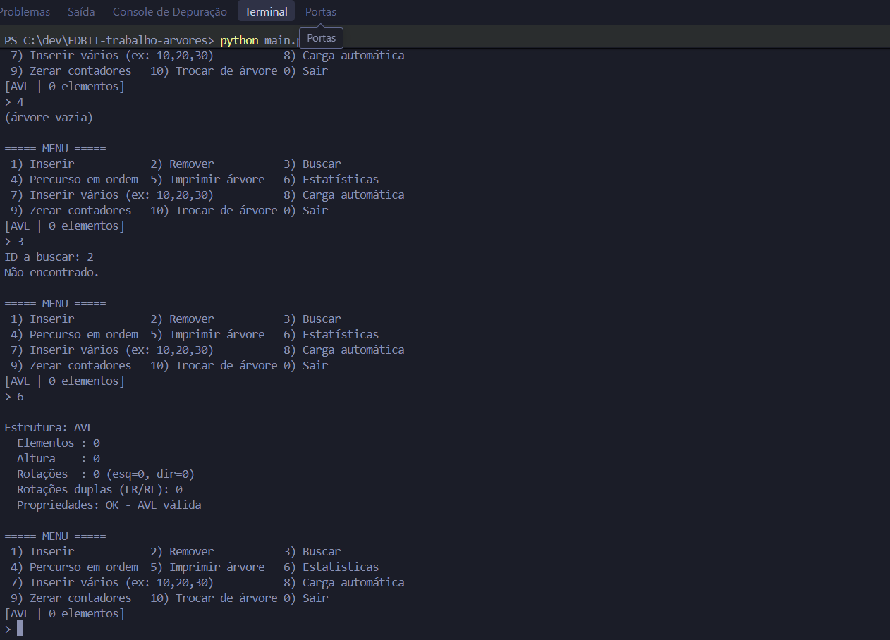

Carga de 1.000 IDs em ordem crescente (altura 10):
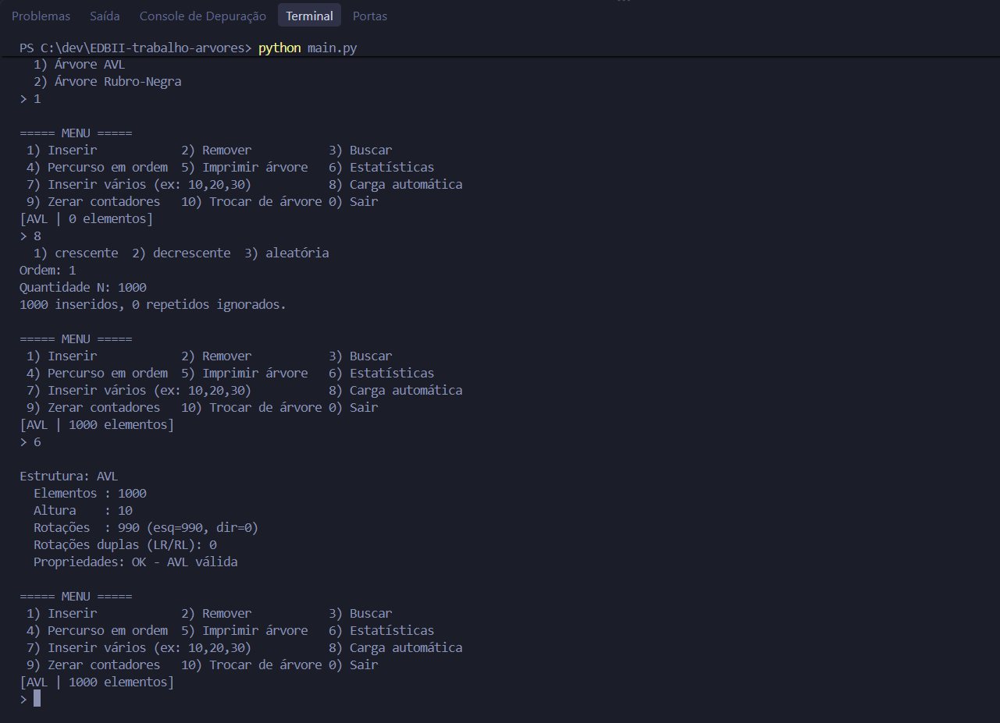

### Árvore Rubro-Negra
Inserção e impressão da árvore (cada nó mostra a cor, R ou B):
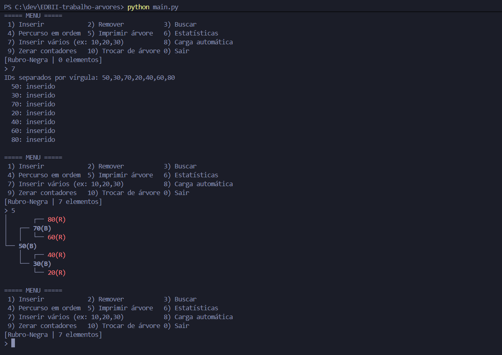

Busca de existente e inexistente, e inserção de valor repetido (ignorada):
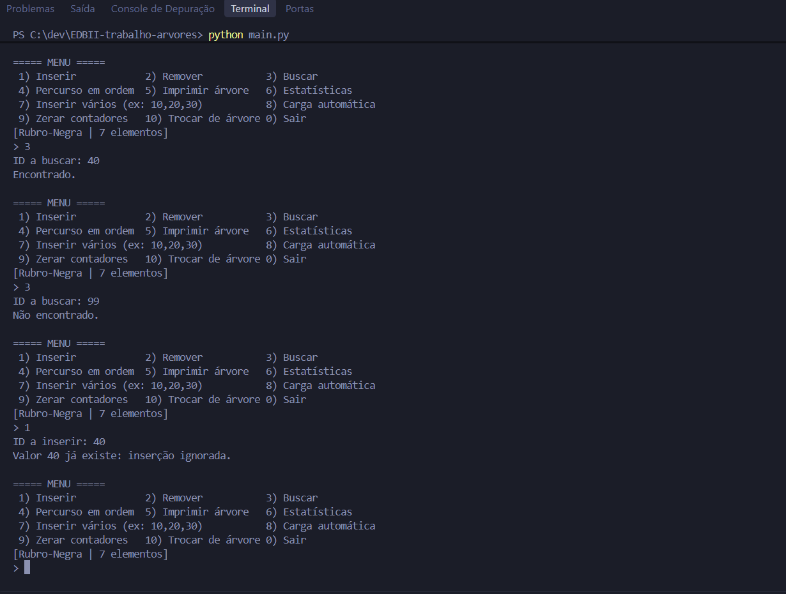

Remoção, percurso em ordem e árvore final com cores:
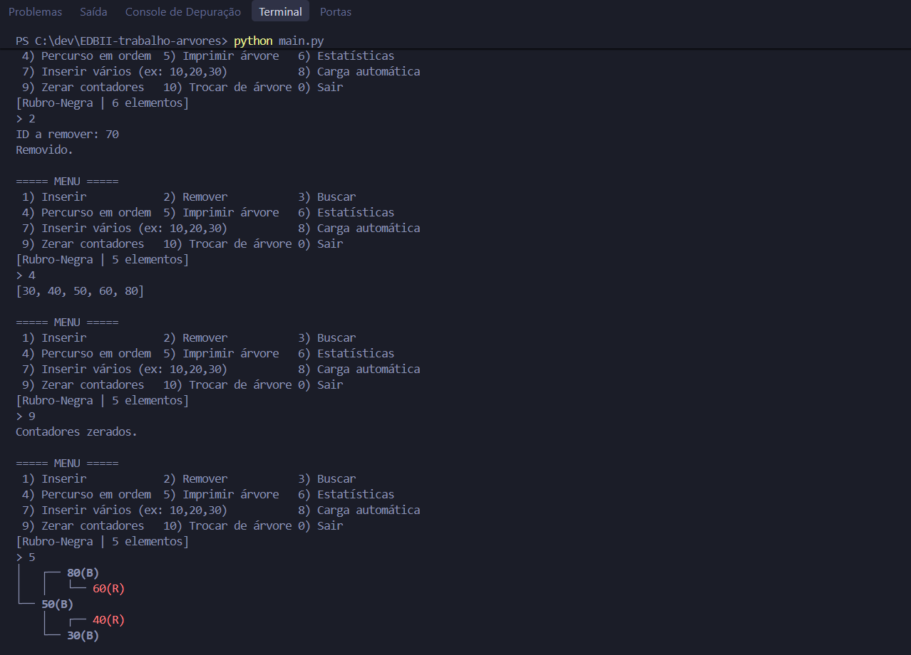

## Referências
- CORMEN et al. *Introduction to Algorithms* (CLRS) – capítulo de árvores rubro-negras.
- https://github.com/nkokor/red-black-tree
- https://github.com/burpeesDaily/forest-python
